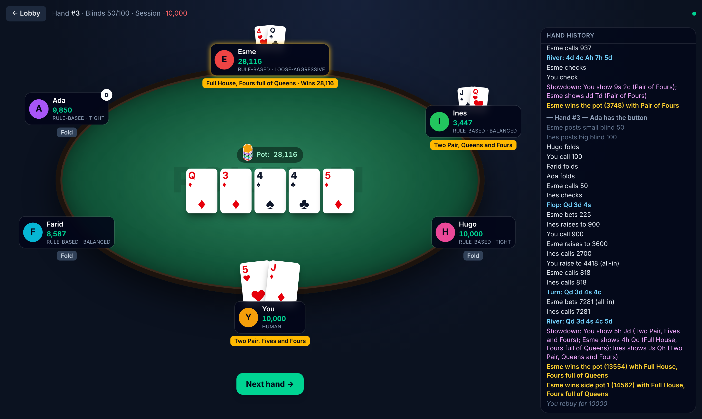
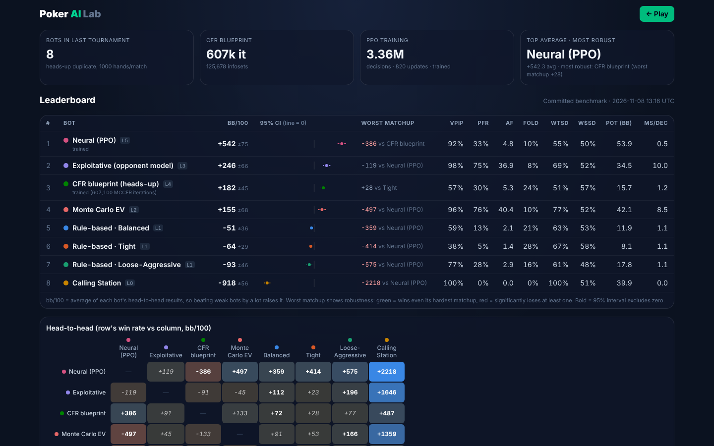
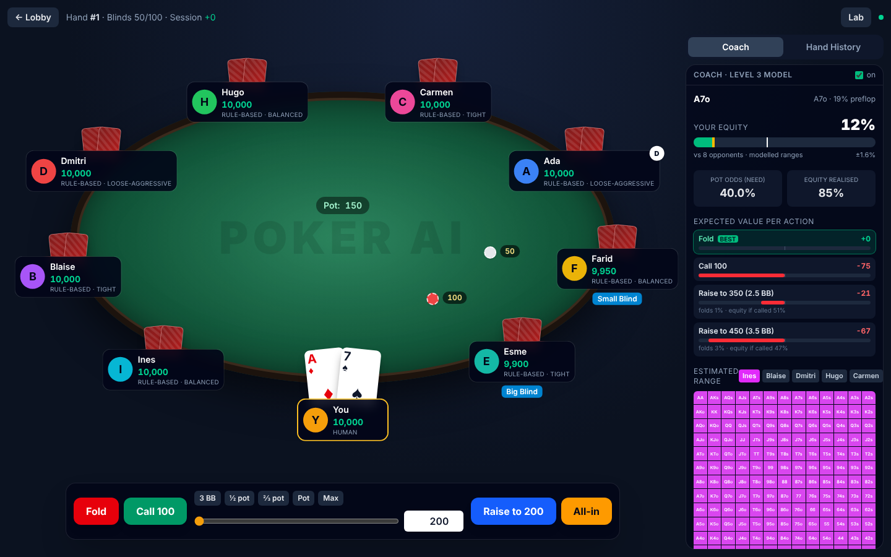
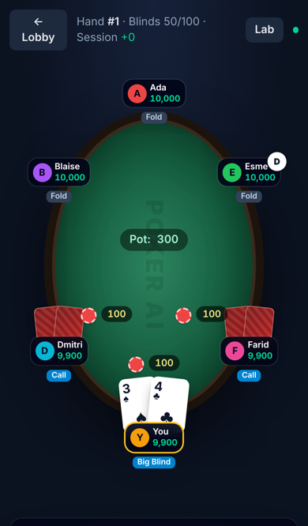

# Poker AI

A playable No-Limit Texas Hold'em platform: a rules-exact engine, a ladder of
AI opponents (rule-based → Monte Carlo → exploitative → CFR blueprint → neural
PPO), a duplicate-match evaluation harness, and a web table with a coach panel.

> **Status:** all 8 milestones complete: the engine, a playable web table (2–9 players,
> desktop and phone) with a Coach, five bot levels (rule-based → Monte Carlo EV →
> exploitative → CFR blueprint → PPO neural), duplicate tournaments, multi-way ring
> evaluation and a Lab dashboard. Limitations are listed honestly at the end.



## Progress

| # | Milestone | Status |
|---|-----------|--------|
| 1 | Engine: evaluator, betting, all-ins, side pots, randomised chip-conservation stress test | ✅ done |
| 2 | Rule-based bots + playable table UI (FastAPI + React vertical slice) | ✅ done, 94 tests total |
| 3 | Monte Carlo equity bot + Coach panel (equity, pot odds, EV per action) | ✅ done |
| 4 | Opponent modelling (Bayesian stats, range narrowing) + 13×13 range heatmap | ✅ done |
| 5 | CFR: verified on Kuhn (game value −1/18) and Leduc via exploitability, then MCCFR blueprint for abstracted heads-up NLHE | ✅ done |
| 6 | Neural agent: PPO with action masking, equity feature, league training | ✅ done |
| 7 | Duplicate tournaments, bb/100 with 95% CIs, Lab dashboard | ✅ done |
| 8 | 3-player / 6-max polish, end-to-end checks, screenshots | ✅ done |

## Architecture

```
poker_ai/
  engine/      cards, hand evaluator, actions + legality, game state, pots, table   ✅
  agents/      random, calling station, rule_based, equity/EV, exploitative, cfr, neural ✅
  solvers/     CFR + exact exploitability (Kuhn, Leduc), abstracted HUNL + MCCFR    ✅
  learning/    features + masking, PPO actor-critic, league rollouts, NumPy policy ✅
  sim/         runner, duplicate matches, round-robin tournaments, play stats      ✅
  server/      FastAPI: WebSocket game sessions + Lab API                           ✅
  data/        preflop table, CFR curves, MCCFR blueprint, PPO weights, results    ✅
web/           React + Tailwind + Framer Motion: Table, Coach, range heatmap, Lab  ✅
tests/
```

**Design rule:** the engine is the only thing that decides what is legal.
`HandState.legal_actions()` produces a `LegalActions` object; `HandState.apply()`
validates every action against it and raises `IllegalActionError` (leaving the
state untouched) otherwise. Agents only ever see a `PlayerView` — their own hole
cards plus public information — so they cannot read hidden cards.

### Bot ladder

| Level | Bot | Core idea |
|-------|-----|-----------|
| 1 | Rule-based (Tight / Balanced / Loose-Aggressive) | hand-strength tiers, position, price to call |
| 2 | Monte Carlo equity | simulate run-outs, compare EV of fold / call / raise |
| 3 | Exploitative | level 2 + Bayesian opponent stats and range narrowing |
| 4 | GTO blueprint | MCCFR on abstracted heads-up NLHE (equity buckets; fold/call/½pot/pot/all-in) |
| 5 | Neural | PPO vs a league of past selves and the fixed bots, masked actions |

## The engine (Milestone 1)

* **Cards** are ints `0..51` (`rank*4 + suit`) for speed; `parse_cards("As Kd")` / `card_str` at the edges.
* **Evaluator** (`engine/hand_evaluator.py`): table-driven, 5–7 cards → one comparable int.
  ~500k 7-card evaluations/sec in pure Python. Verified against an independent
  brute-force evaluator and the exact 2,598,960-hand category distribution.
* **Rules** implemented: heads-up and multi-way blinds/positions (button = SB heads-up),
  antes, BB option, min-raise tracking, short all-ins, **incomplete all-in raises do
  not reopen betting** (but cumulative incomplete raises totalling a full raise do),
  no raising when nobody can respond, uncalled-bet refunds, automatic run-outs,
  side pots with dead money from folded players, split pots, odd chips to the first
  winner left of the button, eliminations and button movement (`Table`).
* **Action convention:** `BET`/`RAISE` amounts are *raise-to* totals for the street.
  All-in is `legal.all_in()`.

Deliberate simplifications: no burn cards (irrelevant to fairness with a uniformly
shuffled deck); a short-stacked big blind still forces others to call the full big
blind; no dead-button rule (the button moves to the next seat with chips).

### Quick example

```python
import random
from poker_ai.engine import HandState, Action

h = HandState(stacks=[1000, 1000], button=0, small_blind=5, big_blind=10, rng=random.Random(1))
la = h.legal_actions()          # seat 0 (button/SB) to act
h.apply(Action.raise_to(30))
h.apply(Action.call())
print(h)                        # HandState(street=flop, ...)
view = h.view(1)                # what seat 1 is allowed to see
```

## Play online (no install)

[](https://render.com/deploy?repo=https://github.com/THE-LEGEND-SKAG/poker_bot)

One click builds the `Dockerfile` (React build + FastAPI server) on Render's free
tier using `render.yaml`. Free instances sleep when idle; the first visit after a
while takes ~30-60 s to wake up.

## Play (Milestone 2)

```bash
pip install -e ".[dev,server]"
```

```bash
cd web && npm install && npm run build && cd ..
```

```bash
python -m poker_ai          # open http://127.0.0.1:8000
```

The lobby lets you choose heads-up, 3-handed or 6-max (up to 8 bots), pick each
opponent's type, set the blinds, starting stack and bot speed. At the table you get
fold / check / call, a bet slider with 3 BB / ½ / ⅔ / pot presets and all-in, and
keyboard shortcuts (`F`, `C`, `R`). The hand history appears in a side panel.
Showdowns reveal the hands that went to showdown, label them, and mark each pot's
winner. Busted bots rebuy automatically; when you bust you choose whether to rebuy.

For frontend development with hot reload, run the server and also run
`cd web && npm run dev` (Vite proxies `/api` and `/ws` to port 8000).

**Level 1 rule-based bot** (`agents/rule_based.py`): preflop hands are graded with
Chen-formula tiers, adjusted for position, number of players and the price to call,
with push/fold below 12 BB. Postflop it enumerates every opponent holding to get its
current hand strength, counts outs for draws, and compares the result with pot odds.
There are three personalities (Tight / Balanced / Loose-Aggressive), with different
thresholds, aggression, bluff frequency and bet size. Every decision records the rule
that fired in `last_explanation`, which the Coach panel will use.

## Level 2: Monte Carlo EV bot and the Coach (Milestone 3)

**Equity** (`agents/equity.py`): our expected share of the pot against each opponent's
holding, drawn at random or from a range. Ties are split. On the river against one
opponent it enumerates every holding exactly; otherwise it samples (about 1,000
samples in 10 ms) and reports a standard error. It reproduces published values:
AA 85.2%, KK 82.4%, AKo 65.4%, 72o 34.6% against one random hand. A precomputed
table (`data/preflop_equity.json`) holds the equity of all 169 starting hands
against 1–5 opponents; rebuild it with `python scripts/build_preflop_table.py`.

**EV model** (`agents/ev.py`): EV is the expected change in our stack from this
decision onward, so folding is always 0.

* call: `R·eq·(pot + call) − call`
* bet/raise to X: `FE·pot + (1−FE)·(R·eq_called·(final pot) − our chips)`

What the terms mean:

* `R` (equity realisation): 1.0 on the river or all-in, 0.95 in position, 0.85 out of position.
* `FE` (fold equity): the chance every opponent folds. Each opponent folds
  `(risk/(risk+reward))^1.5`. A game-theory-balanced defender folds exactly
  `risk/(risk+reward)`, which would make every pure bluff break even; real players
  call more than that, so here pure bluffs lose money.
* `eq_called`: equity against only the hands that continue (the top `1−f` of the caller's range).
* A bettor's range narrows with the size of the bet.

Sizes considered are 2.5/3.5 BB or 3×/4× preflop, and ½ / ¾ / pot postflop. All-in
is considered only when the stack is at most 4× the pot or 15 BB preflop, because a
one-street model can't see the value a smaller bet wins on later streets.

The **Level 2 bot** plays the highest-EV action, choosing at random among options
within 2% of the pot of the best one.

**Coach panel** (toggle in the sidebar): on your turn it runs the same model on
*your* hand. It shows your equity (with the pot odds you need marked on the bar),
your made hand, and the EV of every action, with fold equity and equity-if-called
for each bet size. After each hand it reveals the bots' reasoning. Numbers that
depend on a bot's hidden cards are shown only if those cards were revealed at
showdown, so the coach never leaks information.

**Results** (heads-up duplicate matches, 100 BB stacks, 20,000 hands each, `scripts/quick_match.py`):

| Level 2 vs | Win rate (95% CI) |
|------------|-------------------|
| Rule-based · Tight | +53.1 ± 16.7 bb/100 |
| Rule-based · Balanced | +67.2 ± 23.7 bb/100 |
| Rule-based · Loose-Aggressive | +96.3 ± 32.3 bb/100 |
| Calling Station (2,000 hands) | +1,432 ± 129 bb/100 |

```bash
python scripts/quick_match.py equity rule_balanced 10000
```

**Update (equity realisation):** Level 3 originally under-performed Level 2 against
the Calling Station (+1,222 vs +1,426 bb/100 on identical deals). The cause: its
realisation factor assumed future betting would cost it equity, which a player
who never bets cannot make it do. Level 3 now scales that loss by the opponent's
observed aggression and wins **+1,552 ± 50** on the same deals.

**Known limitations:** EV covers one street (future streets enter only through `R`).
Postflop ranges are ranked by made-hand strength, so draws in an opponent's range
are under-weighted. Without an opponent model, fold rates are population defaults;
Level 3 replaces them with observed statistics.

## Level 3: exploitative bot with opponent modelling (Milestone 4)

**Tendencies** (`agents/opponent_model.py`): for every opponent the model tracks
VPIP (counting only hands where they faced a price; a free big-blind check is not a decision to play), PFR, folding to a preflop raise, betting when checked to, folding to a bet,
raising against a bet, and going to showdown. Each is a Beta distribution that
starts from a population prior worth a few hands and is updated by Bayes' rule
after every hand. Early estimates stay close to typical play and sharpen with
evidence. The model reads only public actions and cards shown at showdown.

**Ranges**: each opponent starts on all 1,326 holdings (minus cards we can see).
Every action in the hand multiplies each holding's weight by the likelihood of
that action with that holding:

`P(hand | actions) ∝ P(hand) · Π P(action | hand, tendencies)`

The likelihoods are smooth functions of hand strength, with thresholds set by
that opponent's stats:

* **Preflop:** strength is the hand's percentile. A 40%-PFR player raises far
  wider than an 8% one, and calls exclude most hands they would have raised.
* **Postflop:** strength is the hand's current percentile on the board, with
  extra credit for flush and straight draws. Bets and raises shift weight toward
  strong hands and draws; checks shift it toward weaker ones.

Learned profiles after 150 hands of observation:

| Bot | VPIP | PFR | Bets when checked to | Folds to bet |
|-----|------|-----|----------------------|--------------|
| Calling Station | 98% | 0.5% | 0.5% | 1% |
| Rule-based · Tight | 35% | 7% | 31% | 30% |
| Rule-based · Loose-Aggressive | 74% | 31% | 54% | 25% |

**The Level 3 bot** (`agents/exploitative.py`) uses the Level 2 EV engine with two
inputs replaced: equity is computed against the modelled ranges, and fold
probabilities shift, on the log-odds scale, by how much more or less often that
opponent folds than the prior. Bluffs therefore come from evidence: a weak hand
bets only when that opponent's fold rate and range make betting the highest-EV
option. It value-bets calling stations and bluffs players who over-fold.

**Coach**: now runs this Level 3 analysis using a model built only from *your*
observations. A 13×13 heatmap shows each live opponent's estimated range (pairs on
the diagonal, suited above, offsuit below) along with their learned stats.

## Level 4: CFR, verified on small games and then scaled up (Milestone 5)

**Step 1: proving the solver** (`solvers/cfr.py`, `solvers/games.py`). Kuhn and
Leduc poker are compiled into explicit game trees. CFR runs with alternating
updates, and exploitability is computed *exactly* with a best response over
information sets:
`(BR₀(σ₁) + BR₁(σ₀)) / 2`, which is 0 only at a Nash equilibrium.

| Game | Infosets | 100 it | 1,000 it | 10,000 it | Game value (target) |
|------|----------|--------|----------|-----------|---------------------|
| Kuhn | 12 | 0.0234 | 0.0065 | **0.0021** | −0.05557 (−1/18 = −0.05556) |
| Leduc | 288 | 0.1295 | 0.0219 | **0.0059** | −0.0860 (−0.0856) |

The exploitability code itself is checked against Kuhn's textbook equilibrium
family: it scores 2×10⁻¹⁷, effectively zero. On this tree vanilla CFR converged
faster than CFR+ (Leduc: 0.0059 vs 0.0145 at 10k iterations), so vanilla is the
default and CFR+ is an option. Rerun with `python scripts/solve_small_games.py 10000`.

**Step 2: the heads-up No-Limit blueprint** (`solvers/hunl.py`). The abstraction:

* **Stacks:** 100 BB.
* **Bets:** fold / call / ½ pot / pot / all-in. At most 3 sized raises preflop,
  2 on the flop, and 1 each on the turn and river (all-in one level further).
* **Cards:** all 169 preflop classes kept separate; postflop, hands are grouped
  into 8 / 8 / 10 equity buckets (flop / turn / river).

That is about 129k information sets. It was trained with external-sampling
MCCFR on 3 processes for 30 minutes: **607,100 iterations, 125,678 information
sets visited**, with average positive regret falling steadily (see the Lab).
Rerun with `python scripts/train_hunl_blueprint.py 30 3`.

**The Level 4 bot** (`agents/cfr_agent.py`) replays the real betting into the
abstraction, mapping odd bet sizes with pseudo-harmonic action translation. It
then buckets its own hand exactly as in training, samples from the average
strategy (dropping actions under 5% to filter noise), and maps the abstract
action back to a real bet. Multiway pots, stacks outside 40–250 BB, unvisited
spots and untranslatable lines fall back to Level 3, and the reason is recorded.
In heads-up play at 100 BB, **99.6%** of its decisions came from the blueprint.

## Level 5: neural agent trained with PPO (Milestone 6)

* **Inputs** (`learning/features.py`, 155 features): own cards, board, Monte Carlo
  equity, made-hand category, draw flag, position, pot/stack/bet sizes in units of
  100 BB, pot odds, SPR, the betting pattern so far, and the opponent's modelled
  stats. A test proves the features are identical whatever the opponent's hidden
  cards are.
* **Actions:** fold / call / ½ pot / pot / all-in. Illegal actions are **masked**
  (logits set to −∞); a test checks every unmasked action against the engine in
  300 random hands.
* **Learning** (`learning/ppo.py`): a PPO actor-critic (2×128 tanh MLP) with a
  value baseline, GAE, normalised advantages, a clipped objective and an annealed
  entropy bonus. The reward is the chip result in 100-BB stacks.
* **League:** the rule-based bots, the Calling Station, Random, the Level 2 bot,
  and frozen snapshots of itself (35% of hands), so it can't overfit to one
  opponent or cycle in self-play.
* **Run:** 45 minutes on 3 processes: 820 updates, 3.36M decisions. Policy
  entropy fell from 1.47 to 0.18; checkpoints are in `checkpoints/`. Rerun with
  `python scripts/train_neural.py 45 3`.
* **Serving:** the exported weights (`data/neural_policy.npz`) are played in
  NumPy, so the server does not need PyTorch.
* **Status label:** *trained* only if the final evaluation beats every rule-based
  bot with 95% confidence. It did: +515 ± 152 (Balanced), +336 ± 135 (Tight),
  +460 ± 170 (Loose-Aggressive).

**Honest caveat:** these wins are against bots it trained with. Against bots
outside its league, the picture is different (6,000-hand duplicate matches):

| Match | bb/100 (95% CI) |
|-------|-----------------|
| CFR (L4) vs Rule-based · Balanced | +63 ± 27 |
| CFR (L4) vs Monte Carlo EV (L2) | +154 ± 63 |
| CFR (L4) vs Exploitative (L3) | +112 ± 56 |
| Exploitative (L3) vs Monte Carlo EV (L2) | +134 ± 100 |
| Neural (L5) vs Monte Carlo EV (L2) | +631 ± 105 |
| Neural (L5) vs CFR (L4) | **−225 ± 72** |
| Neural (L5) vs Exploitative (L3) | **−426 ± 82** |

The neural policy is *exploitative*: it learned to beat the league's habits, but
an opponent that adapts during the match (Level 3) or plays close to equilibrium
(Level 4) beats it.

## Tournaments and the Lab (Milestone 7)

**Duplicate tournaments** (`sim/tournament.py`): every pair plays N deals, each
dealt twice with seats swapped so card luck largely cancels. The output includes:

* head-to-head bb/100 with 95% confidence intervals;
* a leaderboard: each bot's mean result, with the CI combined from the
  independent matches;
* playing stats: VPIP, PFR, aggression factor, fold frequency, went-to-showdown,
  showdown win rate, average pot and average decision time;
* recorded hands for the replayer.

```bash
python -m poker_ai.sim.tournament --agents rule_balanced equity exploit cfr neural --deals 300
```

**Committed benchmark** (8 bots, 1,000 hands per match, seed 2026):

| Bot | Avg bb/100 (95% CI) | Worst matchup |
|-----|---------------------|---------------|
| Neural (PPO) · L5 | +509 ± 75 | −386 vs CFR |
| Exploitative · L3 | +332 ± 63 | −182 vs CFR |
| **CFR blueprint · L4** | +193 ± 46 | **+26 vs Balanced (no losing matchup)** |
| Monte Carlo EV · L2 | +110 ± 66 | −612 vs Neural |
| Rule-based · Balanced / Loose-Aggressive / Tight · L1 | −50 / −60 / −61 | |
| Calling Station · L0 | −972 ± 57 | |

The average rewards crushing weak bots (Neural wins +2,218 against the Calling
Station alone); the worst matchup measures robustness. **CFR is the only bot that
beats every opponent.**



**Lab** (in the web app; also the "Lab" button on the table):

* the leaderboard (with worst matchup) and a head-to-head matrix;
* training curves: CFR exploitability (log-log), MCCFR regret, PPO win rate,
  entropy and per-opponent evaluation;
* a step-through hand replayer;
* a form to launch new tournaments. They run in a separate process, so play stays
  responsive, and are capped at 8 bots × 500 deals.

Charts use a palette validated for colour-vision deficiency on the app's dark
surface. Each bot keeps the same colour everywhere, and every chart has hover
tooltips.

## Multi-way play and final checks (Milestone 8)

**Ring-game evaluation** (`sim/ring.py`): for 3–9 players, each deal is replayed
once per button position, so every bot plays every position with that position's
cards and luck largely cancels. Two pitfalls were found and fixed while building
it:

1. Rotating *bots* through seats every hand scrambled opponent models, which are
   keyed by seat.
2. Fixed seating biases results, because a bot is always stuck directly after the
   same maniac.

The final design plays blocks of deals, each with a random seating order and
fresh bots. Three identical bots net exactly 0 (a test checks this).

```bash
python -m poker_ai.sim.ring --agents neural cfr exploit equity rule_balanced rule_lag --deals 600
```

| Bot | 3-handed bb/100 | 6-max bb/100 |
|-----|-----------------|--------------|
| Neural (PPO) · L5 | **+406 ± 151** | −101 ± 143 |
| CFR · L4 (falls back to L3 multi-way) | −163 ± 140 | +46 ± 107 |
| Exploitative · L3 | −243 ± 129 | **+167 ± 102** |
| Monte Carlo EV · L2 | — | +27 ± 102 |
| Rule-based Balanced / Loose-Aggressive · L1 | — | −39 ± 69 / −99 ± 97 |

3,600 hands each, 10–12 seatings. Read these with their intervals:

* Three-handed, the hyper-aggressive neural policy wins when opponents' models
  restart every 300 hands. With 3,600 hands of continuous learning (same
  seating), Level 3 beat it instead (+131 ± 108 vs +93 ± 148).
* At 6-max, Level 3 is the only significant winner.
* CFR and Level 3 play identically multi-way, by design.

**Table layouts**: 2–9 players on desktop, plus a portrait layout on phones
(compact seats and smaller cards), with no horizontal overflow.





**End-to-end test** (`web/e2e/smoke.mjs`) plays real hands through the browser:

* 6-max on desktop, and heads-up at phone width;
* it raises when it can and rebuys when busted;
* it fails on any browser error, horizontal overflow or a stuck table;
* finally it opens the Lab.

Run it with the server up:

```bash
cd web && npx playwright install chromium && npm run e2e
```

**Clean-environment check**, done for this release:

1. Fresh `git clone` and a new virtualenv **without PyTorch**.
2. `pip install -e ".[dev,server]"` → 147 tests pass; 1 is skipped (the
   PyTorch-only NumPy-vs-PyTorch check).
3. `npm ci && npm run build` succeeds.
4. The e2e test passes against that install.

## Acceptance criteria

| # | Criterion | Evidence |
|---|-----------|----------|
| 1 | A human can play complete games against AI | Web table, 2–9 players; e2e test plays full hands |
| 2 | Rules and betting are correct | 50k-hand random stress test with an independent pot check; side pots, incomplete raises, refunds unit-tested |
| 3 | Distinct AIs share one engine | 9 agent kinds; every action is validated by `HandState.apply` |
| 4 | Monte Carlo equity works | Matches published equities (AA 85.2%, KK 82.4%, 72o 34.6%) |
| 5 | A strategic agent is usable | Level 3 (opponent model) and Level 4 (CFR) in the lobby |
| 6 | A neural agent is trained and its saved model loads | `scripts/train_neural.py`; `data/neural_policy.npz` loads without PyTorch |
| 7 | Automated tournaments | `sim/tournament.py`, `sim/ring.py`, and the Lab form |
| 8 | Metrics can be inspected | Lab: bb/100 ± CI, VPIP, PFR, AF, fold %, WTSD, W$SD, pot size, decision time |
| 9 | Interface works reliably | e2e test on desktop and phone; WebSocket tests |
| 10 | Tests cover edge cases | 149 tests (`pytest`) |
| 11 | Clean install works | Fresh clone + venv check above |

## Limitations (honest)

* **Heads-up specialists:** the CFR blueprint covers heads-up only (100 BB,
  coarse bet sizes) and falls back to Level 3 multi-way. The PPO agent was trained
  heads-up only and is weaker at 6-max.
* **Abstraction:** the blueprint is an approximate equilibrium of a *simplified*
  game, so its exploitability in real No-Limit Hold'em is unknown. Real bet sizes
  are mapped to the nearest abstract sizes.
* **Level 2 and 3 EV models** look one street ahead, with future betting entering
  only through the realisation factor.
* **Neural policy:** strong against the bots it trained with, but exploitable by
  bots that adapt (Level 3) or play near-equilibrium (Level 4).
* **Statistics:** all results are bot-vs-bot at 100 BB. Many 6-max differences
  are within noise at the sample sizes shown.
* **Sessions:** game sessions live in server memory, so a restart ends any game
  in progress (on Render's free tier the server also sleeps when idle).
* **Rules:** no burn cards, no dead-button rule, and a short big blind still
  makes others call the full blind.
* **Known warning:** newer Starlette prints a deprecation warning about `httpx`
  in tests; it has no functional effect.

## Install & test

```bash
pip install -e ".[dev]"
```

```bash
pytest -m "not slow"     # fast suite (~5 s)
```

```bash
pytest                   # includes the exhaustive 2.6M-hand evaluator check (~10 s total)
```

Tests include a randomised stress test: thousands of random hands with 2–9
players, tiny and deep stacks, antes, and deliberately illegal actions; every hand
must conserve chips and its payouts must match an independent chip-by-chip pot
distribution.

## Scope and fairness

Local play and simulation only. This project does not and will not connect to
real-money sites or automate accounts on any platform.
