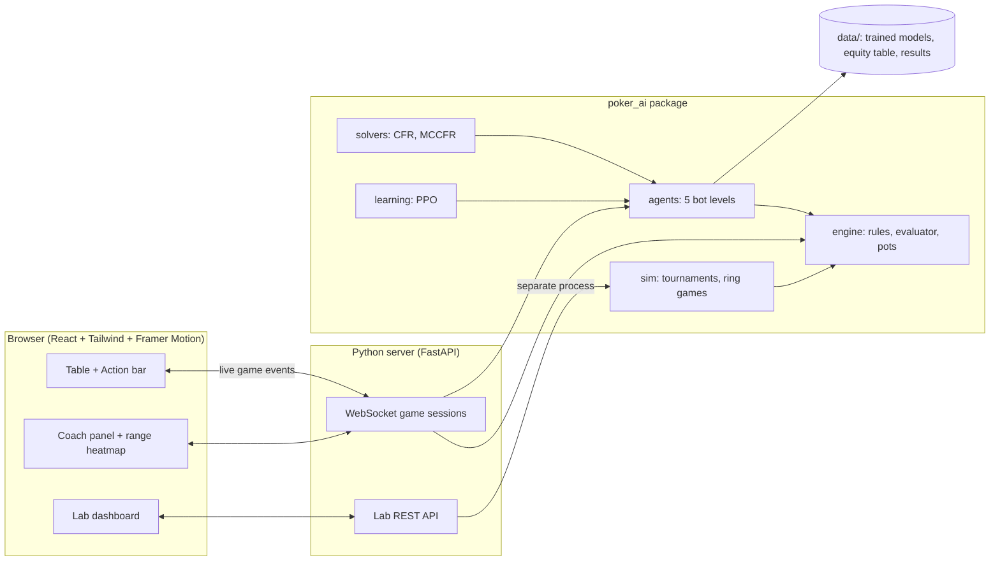
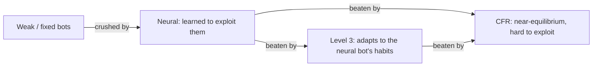

# Poker AI: Technical Report

*A playable No-Limit Texas Hold'em platform with five levels of AI, from hand-written
rules to game-theory solvers and reinforcement learning, plus a statistically sound
evaluation system.*

**Contents**

1. [The project in one minute](#1-the-project-in-one-minute)
2. [System architecture](#2-system-architecture)
3. [The poker engine](#3-the-poker-engine)
4. [The bot ladder](#4-the-bot-ladder)
   - [Level 1: rule-based](#level-1-rule-based)
   - [Level 2: Monte Carlo expected value](#level-2-monte-carlo-expected-value)
   - [Level 3: opponent modelling](#level-3-opponent-modelling-bayesian)
   - [Level 4: CFR game-theory blueprint](#level-4-cfr-game-theory-blueprint)
   - [Level 5: neural network trained with PPO](#level-5-neural-network-trained-with-ppo)
5. [How the bots are evaluated](#5-how-the-bots-are-evaluated)
6. [Results](#6-results)
7. [The web application](#7-the-web-application)
8. [Bugs found and what they taught](#8-bugs-found-and-what-they-taught)
9. [Testing and quality](#9-testing-and-quality)
10. [Limitations and next steps](#10-limitations-and-next-steps)
11. [Explaining it: likely questions and answers](#11-explaining-it-likely-questions-and-answers)
12. [Glossary](#12-glossary)
13. [Reproducing everything](#13-reproducing-everything)

---

## 1. The project in one minute

**What it is.** A complete poker application, not just experiments:

* A rules-exact Texas Hold'em engine.
* Five AI opponents of increasing sophistication.
* A web table where a human can play them, with a Coach that explains the maths
  of each decision.
* A "Lab" that runs fair tournaments between the bots and shows how they were trained.

**The five levels**, each built on ideas from the one below:

| Level | Bot | One-line idea |
|-------|-----|---------------|
| 1 | Rule-based | Hand-written thresholds: play strong hands, fold weak ones |
| 2 | Monte Carlo EV | Simulate the rest of the hand thousands of times; pick the action worth the most chips |
| 3 | Exploitative | Level 2 plus a Bayesian model of each opponent's habits and likely cards |
| 4 | CFR blueprint | Approximate game-theory-optimal strategy, computed by regret minimisation |
| 5 | Neural (PPO) | A neural network that learned by playing millions of hands |

**Headline findings**

* The engine was verified against 50,000 random hands with an independent pot
  calculation, and against all 2,598,960 five-card hands.
* The CFR solver was **proven correct** on two small poker games with known answers.
* In heads-up play, the **CFR bot is the only one with no losing matchup**. It beats
  every other bot, including the neural one.
* The neural bot posts the **highest average** score because it crushes weak bots,
  but adaptive bots beat it. That is the classic trade-off between *exploitative*
  and *equilibrium* play, and the evaluation system was designed to expose it.

---

## 2. System architecture



| Package | Responsibility |
|---------|----------------|
| `engine/` | Cards, hand evaluator, game state machine, legal actions, side pots, multi-hand table |
| `agents/` | All bots plus shared tools: equity, ranges, EV analysis, opponent model |
| `solvers/` | CFR for small games, exact exploitability, abstracted heads-up game, MCCFR trainer |
| `learning/` | Neural features, action masking, PPO training, league rollouts, NumPy inference |
| `sim/` | Hand runner, duplicate matches, tournaments, multi-way ring games, statistics |
| `server/` | Game sessions over WebSocket, Lab API |
| `web/` | The React application |

**The most important design rule: the engine is the single source of truth.**
No bot can change the game state directly:

1. The bot receives a `PlayerView`: its own cards and public information only.
2. It returns an `Action`.
3. The engine checks the action against `legal_actions()` and rejects anything
   illegal, without changing anything.

This makes cheating structurally impossible. A bot cannot see hidden cards and
cannot bet chips it doesn't have, and there are tests that prove it.

---

## 3. The poker engine

### 3.1 Cards and hand evaluation

A card is an integer 0–51: `rank × 4 + suit`. Integers are fast to compare and
hash, which matters when evaluating millions of hands.

**Evaluator.** It takes the best 5-card hand out of 5–7 cards and turns it into
**one integer**, so comparing two hands is just `>`:

```
score = category << 20 | r1 << 16 | r2 << 12 | r3 << 8 | r4 << 4 | r5
```

* `category` runs from 0 (high card) to 8 (straight flush).
* `r1…r5` are the tie-breaking ranks, most important first.

It is table-driven. Each suit's cards become a 13-bit mask, and lookup tables
precomputed for all 8,192 masks give "highest straight in this mask" and "top 5
ranks of this mask". A flush therefore takes one lookup instead of a search.
Speed: about **500,000 seven-card hands per second** in pure Python.

**Verification**:

* It agrees with an independent brute-force evaluator (best of all 21 five-card
  combinations) on 9,000 random hands.
* Over **all 2,598,960** five-card hands it reproduces the exact textbook counts
  for every category (e.g. 40 straight flushes, 4 of them royal).

### 3.2 The game state machine

`HandState` plays exactly one hand: blinds, antes, four betting rounds, showdown
and pot distribution. The hardest rules are the ones beginners' engines get wrong:

* **Minimum raise.** A raise must be at least as large as the previous raise.
* **Incomplete all-in raises.** If a player goes all-in for less than a full
  raise, players who already acted may only call or fold; they cannot re-raise.
  Two small all-ins that *together* add up to a full raise do reopen the betting
  (the official tournament rule). This is implemented by remembering, for each
  player, the bet level when they last acted.
* **Uncalled bets** are returned. If you bet 500 and everyone folds, 500 isn't
  "won"; it was never matched.
* **Side pots.** Players who are all-in for different amounts create layered pots.
  Folded players' chips are "dead money": they count toward pots but the folded
  player can't win them.
* **Split pots and odd chips.** An odd chip goes to the first winner left of the button.

**Side-pot algorithm**, by example. Contributions are A = 100, B = 300 and
C = 300, with A all-in:

| Layer | Chips | Who can win |
|-------|-------|-------------|
| 0–100 | 100 × 3 = 300 | A, B, C (main pot) |
| 100–300 | 200 × 2 = 400 | B, C (side pot) |

Each layer is awarded to the best hand among the players eligible for it.

### 3.3 Information hiding

`HandState.view(seat)` builds the `PlayerView`: that seat's own two cards, the
board, stacks, bets and the public action history. Hole cards appear only for
hands shown at showdown. Tests check that two situations which differ *only* in
an opponent's hidden cards produce identical views and identical bot inputs.

---

## 4. The bot ladder

### Level 1: rule-based

Hand-written logic, deliberately transparent.

* **Preflop:** hands are scored with the *Chen formula* (AA = 20, 72o = −1),
  adjusted for position (later is better) and number of players.
* **Postflop:** the bot computes **hand strength**, the share of all possible
  opponent hands (up to 1,081) that it beats right now. It adds **outs** (cards
  that would improve it) and compares the result with **pot odds**.
* **Personalities:** Tight, Balanced and Loose-Aggressive, which differ only in
  their thresholds, aggression and bluff frequency.

### Level 2: Monte Carlo expected value

**Equity** is the share of the pot you'd win on average at showdown. It is
estimated by simulation:

1. Deal random cards to the opponents and complete the board.
2. Evaluate who wins; ties split the pot.
3. Repeat about 500–1,500 times and average.

On the river against one opponent it counts every possible hand exactly instead
of sampling. It matches published values: AA 85.2%, KK 82.4%, 72o 34.6% against
one random hand.

**Expected value (EV)** of each action is measured from now on, so **folding is
always 0** (chips already in the pot are gone either way):

* **Call:** `EV = R · equity · (pot + call) − call`
* **Bet or raise:** `EV = FE · pot + (1 − FE) · (R · equity_when_called · final_pot − our_chips)`

| Term | Meaning |
|------|---------|
| `R` (realisation) | How much of its equity a hand actually gets to use: 1.0 on the river or all-in; less otherwise, because future betting can force you off a hand (0.95 in position, 0.85 out of position) |
| `FE` (fold equity) | Probability that every opponent folds |
| `equity_when_called` | Equity against only the hands that *continue*: callers have stronger hands than average |

**Fold model.** A game-theory-balanced defender folds exactly
`risk / (risk + reward)`; this is the *minimum defence frequency*, MDF. The bot
uses `(risk / (risk + reward))^1.5`, i.e. it assumes opponents call a bit more
than that. Why this matters is in [section 8](#8-bugs-found-and-what-they-taught).

**Bet sizes considered:**

* Preflop: 2.5 or 3.5 big blinds to open, 3× or 4× to re-raise.
* Postflop: ½, ¾ or a full pot.
* All-in only when the stack is at most 4× the pot, or preflop at 15 BB or less.

The bot picks the highest-EV action, choosing randomly among actions within 2%
of the pot of the best one so it isn't perfectly predictable.

### Level 3: opponent modelling (Bayesian)

Level 3 is Level 2 with two inputs replaced by **learned** ones.

**1. Tendencies as Beta distributions.** For every opponent it tracks how often
they play a hand (VPIP), raise preflop (PFR), bet when checked to, fold to a bet,
and so on. Each stat starts from a population prior worth a few hands:

```
prior Beta(a, b)  →  observe success: a += 1   /   failure: b += 1
estimate = a / (a + b)
```

After 3 hands the estimate barely moves from the prior; after 150 hands it
reflects the player. That is Bayesian shrinkage: no overreaction to small samples.

**2. Ranges with Bayes' rule.** Every opponent starts on all 1,326 possible
holdings. Each action they take reweights every holding by how likely that action
would be *with that holding, for that player*:

```
P(hand | actions) ∝ P(hand) × Π P(action | hand, player's tendencies)
```

Example: a player who raises 8% of hands and then raises has a range concentrated
on AA–TT and AK. The same raise from a 40% raiser keeps a much wider range. A
check after a bet on the previous street shifts weight toward weaker hands.

The model then changes decisions in three ways:

* Equity is computed against these modelled ranges.
* Fold probabilities shift by how often that player actually folds.
* Equity realisation scales with how aggressive the opponents really are.

So bluffs are **evidence-based**: the bot bluffs players who over-fold and
value-bets players who never fold.

The Coach panel runs the same model on *your* observations and draws each
opponent's estimated range as a 13×13 heatmap.

### Level 4: CFR game-theory blueprint

**The idea.** In a two-player zero-sum game there is a *Nash equilibrium*: a
strategy that cannot lose on average against any opponent. **Counterfactual
Regret Minimization (CFR)** finds it by self-play:

1. At every decision point ("information set"), track the **regret** for each
   action: how much better you would have done by always playing it.
2. Play each action in proportion to its positive regret (*regret matching*).
3. Repeat. The **average** strategy over all iterations converges to equilibrium.

```
regret[a] += (value of a) − (value of current strategy)     weighted by opponent reach
strategy[a] = max(regret[a], 0) / Σ max(regret, 0)
```

**Step 1: prove the solver on games with known answers.** Kuhn poker (3 cards)
and Leduc poker (6 cards, two rounds) are small enough to compute the exact
**exploitability**: how much a perfect opponent who knows your strategy could win
against it. It is 0 only at equilibrium.

| Game | Info sets | After 100 it | After 1,000 it | After 10,000 it | Game value found (known) |
|------|-----------|--------------|----------------|-----------------|--------------------------|
| Kuhn | 12 | 0.0234 | 0.0065 | **0.0021** | −0.05557 (−1/18 = −0.05556) |
| Leduc | 288 | 0.1295 | 0.0219 | **0.0059** | −0.0860 (≈ −0.0856) |

The exploitability calculator was itself verified on Kuhn's textbook equilibrium:
it scores about 10⁻¹⁷, effectively zero.

**Step 2: scale up to real poker.** Full No-Limit Hold'em is far too large, so it
is **abstracted**:

| Simplification | Choice |
|----------------|--------|
| Bet sizes | Fold, call, ½ pot, pot, all-in. At most 3 sized raises preflop, 2 on the flop, 1 each on the turn and river |
| Cards | All 169 preflop hand types kept separate. Postflop, hands grouped into 8 / 8 / 10 **buckets** by equity |
| Stacks | 100 big blinds |

**Monte Carlo CFR (MCCFR, external sampling)** samples one deal per iteration
instead of walking the whole tree:

* At the trained player's decisions, every action is explored.
* At the opponent's decisions, one action is sampled.

The run used 3 CPU processes for 30 minutes: **607,100 iterations covering
125,678 information sets**, with average positive regret falling steadily.

**Playing real poker from the blueprint**:

1. **Action translation.** A real bet of, say, 0.75× pot isn't in the abstraction.
   The *pseudo-harmonic mapping* (Ganzfried & Sandholm) decides which abstract
   size to treat it as. It is designed to be hard to exploit; here it maps 0.75×
   pot to "pot" with 57% probability.
2. **Bucket its own hand** exactly as in training, look up the strategy, drop
   actions under 5% (noise from rarely visited spots), and sample an action.
3. **Map back** to a real, legal bet size.
4. **Fall back** to Level 3 when the blueprint doesn't apply (multi-way pots,
   unusual stack depths, unvisited spots). This happens in only **0.4%** of
   heads-up decisions at 100 BB.

### Level 5: neural network trained with PPO

**What the network sees** (155 numbers):

* its cards and the board (one-hot);
* hand equity and made-hand category, plus a draw flag;
* position, pot / stack / bet sizes, pot odds and stack-to-pot ratio;
* the betting pattern so far;
* the opponent's modelled stats (from Level 3's model).

**What it outputs:** a probability for each of 5 actions (fold, call, ½ pot, pot,
all-in) plus a value estimate. **Illegal actions are masked**: their logits are
set to −∞, so the network cannot choose them.

**Architecture:** 155 → 128 → 128 (tanh) → policy head (5) and value head (1).

**Why PPO and not DQN?** DQN assumes a fixed environment. In poker the opponent
adapts, so the target moves. PPO (Proximal Policy Optimisation) is an
actor-critic method that learns a probability distribution over actions (needed
for mixing and bluffing) and limits each update to a "safe" step:

```
L = −min(ratio · A, clip(ratio, 0.8, 1.2) · A) + 0.5 · value_loss − c · entropy
ratio = π_new(a|s) / π_old(a|s)
```

**Reducing noise.** Poker rewards are extremely noisy:

* A learned **value baseline** with GAE (λ = 0.9) turns raw outcomes into
  *advantages*: how much better than expected the action did.
* Advantages are normalised per batch, and gradients are clipped at 0.5.

**Why a league and not plain self-play.** Pure self-play can go in circles
(strategy A beats B, B beats C, C beats A). The bot trained against a **league**:

* the 3 rule-based personalities, the Calling Station, Random and the Level 2 bot;
* frozen snapshots of its own past versions (35% of hands).

| Hyperparameter | Value |
|----------------|-------|
| Optimiser | Adam, learning rate 3·10⁻⁴ |
| Batch | 4,096 decisions per update; 4 epochs; minibatches of 512 |
| Entropy bonus | 0.01, annealed to 0.002 |
| Training | 45 minutes, 3 processes, 820 updates, **3.36M decisions** |

During training, the win rate rose from −278 to about +600 bb/100 and policy
entropy fell from 1.47 to 0.18 (the policy became decisive).

**Deployment trick.** Training uses PyTorch, but the trained weights are exported
to a NumPy file and the server runs the network in NumPy. The server therefore
doesn't need PyTorch, which matters on a 512 MB free hosting tier.

**Honest labelling.** The label "trained" is earned only if the final evaluation
beats all three rule-based bots with 95% confidence. It did (+336 to +515 bb/100).

---

## 5. How the bots are evaluated

Poker is noisy: a bad bot can win 1,000 hands through luck. Three techniques make
results trustworthy.

**1. Duplicate matches (heads-up).** Every deal is played **twice with seats
swapped**, so each bot gets both sets of cards and most card luck cancels:

```
deal #1:  A holds AK, B holds 72   →  result r1
deal #1:  B holds AK, A holds 72   →  result r2      A's score for the pair = (r1 + r2) / 2
```

**2. Win rate with confidence intervals.** Results are in **bb/100** (big blinds
won per 100 hands) with a **95% confidence interval** from the per-pair spread:
`mean ± 1.96 × sd / √pairs`. A result counts as real only if the interval
excludes zero.

**3. Multi-way ring games.** For 3–9 players, each deal is replayed once per
button position. Cards follow position, so everyone plays every position with
those cards. Two subtle biases had to be removed; see
[section 8](#8-bugs-found-and-what-they-taught).

**Round-robin tournament.** Every pair of bots plays a duplicate match, which
gives three outputs:

* **Leaderboard:** each bot's average result.
* **Worst matchup:** its weakest head-to-head result.
* **Playing stats:** VPIP, PFR, aggression factor, fold %, showdown %, average
  pot and decision time.

---

## 6. Results

### Heads-up tournament (8 bots, 1,000 hands per match)

| Bot | Average bb/100 (95% CI) | Worst matchup |
|-----|-------------------------|---------------|
| Neural (PPO), L5 | +509 ± 75 | −386 vs CFR |
| Exploitative, L3 | +332 ± 63 | −182 vs CFR |
| **CFR blueprint, L4** | +193 ± 46 | **+26 vs Balanced (never loses)** |
| Monte Carlo EV, L2 | +110 ± 66 | −612 vs Neural |
| Rule-based (3 styles), L1 | −50 to −61 | |
| Calling Station, L0 | −972 ± 57 | |

**How to read this.** The average rewards beating weak bots by a lot: the neural
bot wins +2,218 against the Calling Station alone. The **worst matchup** measures
robustness, and there **CFR wins**: it beats every opponent.

### Head-to-head highlights (6,000 hands each)

| Match | bb/100 (95% CI) |
|-------|-----------------|
| CFR vs Level 3 | +112 ± 56 |
| CFR vs Level 2 | +154 ± 63 |
| Level 3 vs Level 2 | +134 ± 100 |
| Neural vs CFR | **−225 ± 72** |
| Neural vs Level 3 | **−426 ± 82** |

### Multi-way (3,600 hands each)

| Bot | 3-handed | 6-max |
|-----|----------|-------|
| Neural | **+406 ± 151** | −101 ± 143 |
| CFR (uses Level 3 multi-way) | −163 ± 140 | +46 ± 107 |
| Exploitative, L3 | −243 ± 129 | **+167 ± 102** |

The neural bot was trained heads-up only, so it does well short-handed but not at
6-max. Most 6-max differences are within noise at this sample size.

### The story the numbers tell



This is the central trade-off in game AI. **Exploitative** play wins the most
against weak opponents but can itself be exploited. **Equilibrium** play is
robust: it may win less against weak players, but nobody beats it.

---

## 7. The web application

* **Real-time play.** FastAPI keeps one WebSocket per game. Bots "think" with a
  short delay and run in a background thread, so the table never freezes. Every
  state update sent to the browser is built from the human's point of view: no
  bot cards until showdown.
* **The table:**
  * an oval felt with animated cards and chips, built with React, Tailwind and
    Framer Motion;
  * a bet slider with ½ / ⅔ / pot presets and keyboard shortcuts (F, C, R);
  * 2–9 players, with a portrait layout on phones.
* **Coach panel:**
  * your equity bar with the pot-odds line, and the EV of every action;
  * a 13×13 range heatmap for each opponent;
  * after each hand, the bots' reasoning. Numbers that depend on a bot's hidden
    cards are only revealed if those cards were shown.
* **Lab:**
  * the leaderboard and head-to-head matrix;
  * training curves for CFR exploitability, MCCFR regret, PPO win rate, entropy
    and evaluation;
  * a hand replayer;
  * a form to launch tournaments, which run in a **separate process** so the
    game server stays responsive.
* **Charts:** a colour palette validated for colour-vision deficiency, a single
  axis per chart, and hover tooltips.
* **Deployment:** a two-stage Docker build (Node builds the web app; Python
  serves it), deployed on Render. The full server uses about 104 MB of memory.

---

## 8. Bugs found and what they taught

These make good interview stories: each was found by measuring, not guessing.

| # | Symptom | Root cause | Fix | Lesson |
|---|---------|------------|-----|--------|
| 1 | Level 2 wanted to re-raise with 72o | If opponents fold exactly at MDF, *every* pure bluff breaks even, so a raise always beats a fold | Assume opponents call a bit more than MDF (`MDF^1.5`) | A model's assumptions can create loopholes the optimiser will find |
| 2 | Level 2 shoved 100 BB with AA preflop | A one-street EV can't see the value a smaller bet wins on later streets | Commitment rule: all-in only when stack ≤ 4× pot | Know what your model can't see, and constrain it there |
| 3 | Level 3 beat Level 2 overall but did *worse* against the Calling Station | Level 3 correctly learned the station never folds, but still assumed future betting would cost it equity; a player who never bets can't do that | Scale the equity-realisation loss by observed aggression | Fix the right assumption; the result improved from +1,222 to +1,552 bb/100 |
| 4 | The station's VPIP read 75% instead of ~100% | A free big-blind check was counted as "chose not to play" | Count VPIP only when facing a price | Definitions matter; check stats against cases where you know the answer |
| 5 | CFR converged slower than expected | Traversal skipped opponent branches with zero probability, so our average strategy wasn't updated there | Remove the pruning | Pruning is safe for regrets but not for the average strategy |
| 6 | Neural bot looked best at 6-max | The evaluator rotated *bots* through seats each hand, scrambling opponent models keyed by seat | Rotate the button instead | Your evaluation harness can be the bug |
| 7 | CFR and Level 3 (identical multi-way) scored very differently | With fixed seats, CFR always sat directly after the aggressive neural bot | Blocks with random seating and fresh bots | Fixed relative positions bias multi-way results |

---

## 9. Testing and quality

**149 automated tests** (`pytest`), plus a browser end-to-end test:

| Area | What's tested |
|------|---------------|
| Evaluator | All 2.6M five-card hands; independent brute-force comparison |
| Engine | Blinds and positions, min-raises, incomplete all-ins, uncalled bets, side pots, splits, odd chips, illegal actions rejected without changing state |
| Stress | Thousands of random hands (2–9 players, tiny and deep stacks, antes, deliberate illegal moves); chips must be conserved and payouts must match an independent chip-by-chip calculation |
| Fairness | Bots never see hidden cards; views identical whatever the opponent holds |
| Bots | Every bot returns legal actions in hundreds of random situations |
| Solvers | Kuhn exact equilibrium scores 0; CFR converges on Kuhn and Leduc to the known values |
| Neural | Masks match engine legality; the NumPy forward pass equals PyTorch's |
| Server | Full WebSocket games; coach never analyses bots' decisions; review hides mucked cards |
| Evaluation | Tournaments are zero-sum; three identical bots in a ring net exactly 0 |
| End-to-end | `npm run e2e` plays real hands in a browser on desktop and phone and opens the Lab |

A **clean-environment check** was also done: a fresh clone, a new environment
without PyTorch, installation from the README, all tests passing, and the e2e
test passing.

---

## 10. Limitations and next steps

**Limitations**

* The CFR blueprint covers heads-up only, at 100 BB, with coarse bet sizes. It is
  an equilibrium of a *simplified* game, so its exploitability in real No-Limit
  is unknown.
* The neural bot was trained heads-up only and is exploitable by adaptive bots.
* Level 2 and Level 3 look one betting round ahead.
* All results are bot-vs-bot. Many 6-max differences are within noise.

**Next steps, in order of value**

1. Train the neural bot against a league that includes Level 3 and CFR, and at
   3–6 player tables. That targets its main weakness.
2. A finer blueprint: more bet sizes, more buckets, and longer training (or
   Deep CFR, which replaces the lookup table with a network).
3. **Real-time search** (re-solving the current spot during play), the technique
   that took Libratus and Pluribus from strong to superhuman.

---

## 11. Explaining it: likely questions and answers

**"What's the hardest part of a poker engine?"**
The betting rules around all-ins: incomplete raises that don't reopen the betting,
uncalled-bet refunds and side pots. I proved correctness by checking 50,000 random
hands against an independent chip-by-chip pot calculation.

**"Why is poker harder for AI than chess?"**
It's an *imperfect-information* game: you can't see opponents' cards, so the best
move depends on *beliefs*, and good strategies must be randomised (otherwise
you're predictable). Chess algorithms like minimax don't apply directly; CFR was
designed for exactly this setting.

**"How do you know your CFR is correct?"**
I ran it on Kuhn poker, which has a known exact solution (game value −1/18), and
on Leduc. I measured exploitability exactly with a best-response computation and
watched it fall towards zero. I also verified the best-response code itself on
the textbook equilibrium, where it scores zero.

**"What is exploitability?"**
How much a perfect opponent who knows your strategy could win per hand. Zero means
Nash equilibrium: nobody can beat you on average.

**"Why PPO instead of DQN?"**
Poker opponents adapt, so the environment isn't fixed (DQN assumes it is). Poker
also needs randomised strategies, which a policy method represents directly. PPO
is stable because it clips each update.

**"How did you deal with noisy rewards?"**
In training: a learned value baseline with GAE, normalised advantages and large
batches. In evaluation: duplicate matches (same cards both ways) and 95%
confidence intervals.

**"Your neural bot has the best average but loses to CFR. Is that a failure?"**
It's the expected trade-off. The neural bot learned to exploit the opponents it
trained against. CFR approximates equilibrium, so it is robust. That's why the
leaderboard reports the worst matchup as well as the average.

**"How does the opponent model work?"**
Each stat is a Beta distribution updated by Bayes' rule after every hand, starting
from a population prior so a few hands don't cause overreaction. For ranges,
every action reweights all 1,326 possible hands by how likely that player would
take that action with that hand.

**"How do you stop the AI cheating?"**
Bots only receive a view with their own cards plus public information, and every
action passes the engine's legality check. Tests prove that changing an opponent's
hidden cards doesn't change anything a bot sees.

**"What would you do with more time?"**
Real-time search (re-solving), a bigger abstraction or Deep CFR, and training the
neural bot against the stronger bots and at full tables.

---

## 12. Glossary

| Term | Meaning |
|------|---------|
| **bb/100** | Big blinds won per 100 hands, the standard win-rate unit |
| **Equity** | Your expected share of the pot if the hand went to showdown |
| **Pot odds** | `call / (pot + call)`: the equity a call needs to break even |
| **EV** | Expected value: the average chips an action wins or loses |
| **Range** | The set of hands a player could have, with weights |
| **VPIP** | Voluntarily put money in pot: how often a player plays a hand |
| **PFR** | Preflop raise frequency |
| **AF** | Aggression factor: (bets + raises) / calls after the flop |
| **WTSD / W$SD** | Went to showdown / won money at showdown |
| **MDF** | Minimum defence frequency: how often you must continue so bluffs don't profit automatically |
| **SPR** | Stack-to-pot ratio |
| **Information set** | All game situations a player can't tell apart (same own cards and public history) |
| **Nash equilibrium** | Strategies where nobody gains by changing theirs alone |
| **Regret** | How much better an action would have done than what was played |
| **CFR / MCCFR** | Counterfactual Regret Minimization, and its sampled Monte Carlo version |
| **Abstraction** | A simplified version of the game, small enough to solve |
| **Action translation** | Mapping real bet sizes onto the abstraction's sizes |
| **PPO** | Proximal Policy Optimisation, a stable actor-critic RL algorithm |
| **GAE** | Generalised Advantage Estimation, which reduces variance in RL training |
| **Action masking** | Forcing an illegal action's probability to zero |
| **Duplicate poker** | Playing every deal twice with seats swapped to cancel card luck |
| **Heads-up / 6-max** | Two players / up to six players |

---

## 13. Reproducing everything

```bash
pip install -e ".[dev,server]"
```

```bash
cd web && npm ci && npm run build && cd ..
```

```bash
python -m poker_ai                                   # play at http://127.0.0.1:8000
```

```bash
pytest                                               # 149 tests
```

```bash
python scripts/solve_small_games.py 10000            # CFR on Kuhn and Leduc
```

```bash
python scripts/train_hunl_blueprint.py 30 3          # MCCFR blueprint (30 min, 3 processes)
```

```bash
pip install torch && python scripts/train_neural.py 45 3   # PPO (45 min, 3 processes)
```

```bash
python -m poker_ai.sim.tournament --agents rule_balanced equity exploit cfr neural --deals 300
```

```bash
python -m poker_ai.sim.ring --agents neural cfr exploit equity rule_balanced rule_lag --deals 600
```

```bash
cd web && npm run e2e                                # browser test (server must be running)
```
